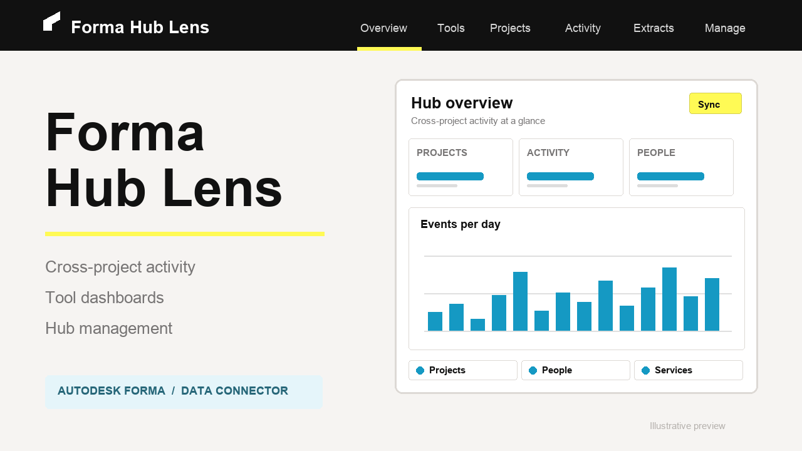

# Forma Hub Lens


[](https://nodejs.org)
[](LICENSE)
[](https://aps.autodesk.com/)


Forma Hub Lens is a local console for Autodesk Forma hub administrators and members with Executive Overview access. It combines cross-project activity, 21 tool dashboards, Data Connector extracts, and hub management in one Next.js application.

The sample shows how to turn asynchronous Data Connector CSV extracts into a searchable local activity cache and dashboards. It assumes familiarity with three-legged OAuth, Autodesk Construction Cloud, and SQLite.



## Usage

- **Overview, Projects, and Activity:** sync the hub project list, explore ingested activity, and export filtered rows.
- **Extracts:** request activity data through the APS Data Connector API, track those jobs, and ingest completed activity CSVs.
- **Tools:** upload a separate ZIP exported from Autodesk Construction Cloud **Insight › Data Connector** to populate dashboards for the tools present in that extract.
- **Manage:** perform guarded bulk member and project operations.

**Two separate data paths:** On **Extracts**, request and ingest activity CSVs for the Overview, Projects, and Activity pages. For **Tools**, create and download a ZIP in Autodesk Construction Cloud's external Insight Data Connector, then upload it on this app's Tools page. `Sync projects` fills the project list; it does not populate tool dashboards. See the [step-by-step usage guide](docs/USAGE.md#typical-workflow).

## Development

### Prerequisites

- Node.js 22 or later and npm.
- An APS **Traditional Web App** with its Client ID provisioned for the target Autodesk Forma/ACC account under **Hub Admin › Custom Integrations**. See [Provision access in other products](https://get-started.aps.autodesk.com/#provision-access-in-other-products).
- A Forma hub ID and an account with Hub Admin or Executive Overview access.
- An OAuth callback registered on the APS app that exactly matches this app's local callback: `http://localhost:3000/api/aps/callback`. APS tutorial examples often use port 8080; this app runs on **3000**.

### Build and run locally

```bash
npm install
cp .env.example .env.local
# Set APS_CLIENT_ID, APS_CLIENT_SECRET, APS_CALLBACK_URL, and FORMA_HUB_ID.
npm run dev
```

Open <http://localhost:3000> and sign in with a member of the configured hub. Keep `.env.local` private; it is ignored by Git.

## Documentation

- [Usage and local setup](docs/USAGE.md)
- [Architecture and APS endpoints](docs/ARCHITECTURE.md)
- [Docker and deployment considerations](docs/DEPLOYMENT.md)
- [Known limitations and operational notes](docs/LIMITATIONS.md)
- [Troubleshooting](docs/TROUBLESHOOTING.md)

## License

[MIT](LICENSE). Copyright © 2026 Autodesk Platform Services.

## Author

[Autodesk Platform Services](https://github.com/autodesk-platform-services).
