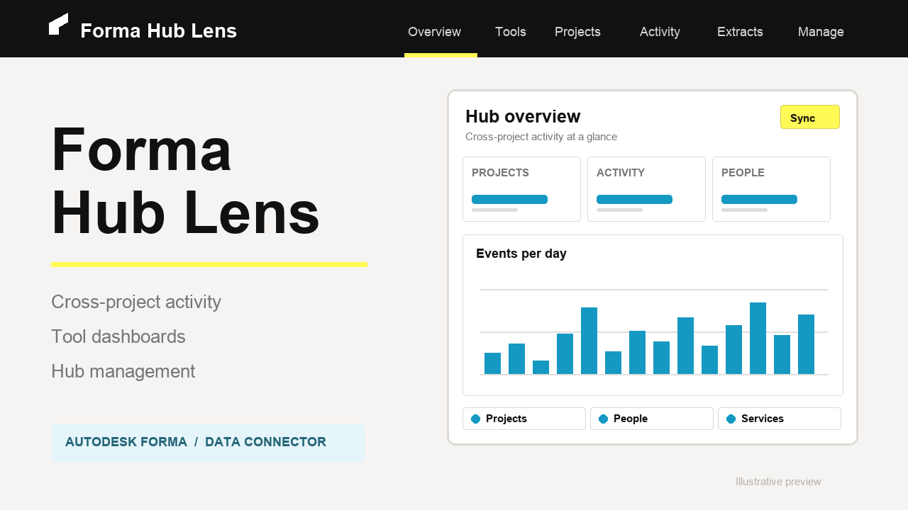

# Forma Hub Lens (Demo)


[](https://nodejs.org)
[](LICENSE)


A public, synthetic demonstration of Forma Hub Lens: one place to explore a Forma portfolio, investigate access and data, review closeout readiness, and practice controlled administrative workflows.

**Synthetic demo hub — all data and administrative actions are simulated. No Autodesk sign-in required.**

Anyone can open the demo directly. No Autodesk account, hub membership, Hub Admin role, Executive Overview role, or Forma subscription is required. The projects, people, companies, dashboards, jobs, integration findings, and closeout evidence are fictional. This deployment makes no APS API calls.



## Try the demo

Preferred public demo target: [forma-hub-lens.autodesk.io](https://forma-hub-lens.autodesk.io/), for deployment on Dokku from the organization's dedicated [`demo` branch](https://github.com/autodesk-platform-services/forma-hub-lens/tree/demo). This source change performs no Dokku deployment. A hosting administrator must switch the configured branch and manually pull and build the new demo source using the [deployment guide](docs/DEPLOYMENT.md).

1. Open the public demo; no sign-in is required.
2. Explore **Overview**, **Projects**, **People & Access**, **Insights**, **Data**, and **Admin**.
3. Open a project, person, or company to follow its fictional relationships.
4. Try **Admin → Bulk management**: configure, preview, confirm, and run a simulation.
5. Use **Reset simulation** to restore that view's initial state.

All 21 tool dashboards are populated from the bundled sample dataset. Administrative simulations stay in the current browser view; they send no invitations, create no Autodesk projects, change no memberships, and assign no subscriptions. Reporting uploads, live scans, Data Connector requests, package generation, and Autodesk downloads are unavailable.

Saved views, watchlist bookmarks, review decisions, and tool favorites use browser-local storage. They do not synchronize across devices or create scheduled monitoring. See [source and persistence limits](docs/LIMITATIONS.md).

## Run locally

Requires **Node.js 24.x** and npm. No APS application, credentials, callback registration, session secret, or environment file is required.

```bash
npm ci
npm run dev
```

Open [localhost:3000](http://localhost:3000). The sample data is loaded automatically; no extract upload or project sync is needed.

The optional settings in `.env.example` are `LENS_MODE=demo` (the default) and `LENS_LIVE_URL`, an external link to a separately hosted live application.

For public hosting, use the [Dokku deployment guide](docs/DOKKU.md). The production container uses Node.js 24, Next.js standalone output, and a non-root process. No persistent volume is required.

## Separate from the live application

The organization's [`demo` branch](https://github.com/autodesk-platform-services/forma-hub-lens/tree/demo) is the anonymous, synthetic build. Its [`main` branch](https://github.com/autodesk-platform-services/forma-hub-lens/tree/main) retains the live implementation. This build rejects live mode and does not use a real Forma hub ID. An optional **Live hub** header link opens a separately configured deployment; it does not change this app's authorization or dataset.

The live application requires Autodesk sign-in, retains its Hub Admin / Executive Overview checks, and requires Hub Admin for administrative changes. The demo branch does not disable those checks on `main`. Changing `LENS_MODE` alone on an existing live `main` deployment will not install this demo; the administrator must fetch and rebuild the `demo` source. A restart or rebuild of an old checkout can keep serving the old code.

The personal [rachermatt/forma-hub-lens-demo repository](https://github.com/rachermatt/forma-hub-lens-demo) and its [Vercel deployment](https://forma-hub-lens.vercel.app/) are unchanged by this branch and are an optional, separate hosting path.

## Documentation

- [Usage and local setup](docs/USAGE.md)
- [Feature guide and source limits](docs/FEATURES.md)
- [Integration Health and Closeout workflows](docs/INTEGRATION-HEALTH-AND-CLOSEOUT.md)
- [Architecture and APS endpoints](docs/ARCHITECTURE.md)
- [Deployment overview](docs/DEPLOYMENT.md)
- [Dokku setup and branch switch](docs/DOKKU.md)
- [Optional Vercel deployment](docs/VERCEL.md)
- [Public demo boundaries](docs/PUBLIC-DEMO.md)
- [Known limitations](docs/LIMITATIONS.md)
- [Troubleshooting](docs/TROUBLESHOOTING.md)

## Development checks

```bash
npm run typecheck
npm test
npm run build
npm run test:smoke
```

Tests use synthetic fixtures and mocked responses; they require no APS credentials or Autodesk sign-in. After deployment, verify that the portfolio opens directly, the synthetic banner remains visible, and administrative actions are simulated.

With Docker available, also check the production image:

```bash
docker build -t forma-hub-lens-demo .
node scripts/smoke-container.mjs forma-hub-lens-demo
```

The container check uses a temporary local container and does not deploy to Dokku.

## License and attribution

[MIT](LICENSE). Original sample copyright © 2026 Autodesk Platform Services. This demo incorporates the synthetic sample maintained under [rachermatt](https://github.com/rachermatt). Autodesk and Forma are trademarks of Autodesk, Inc. The illustrative preview is not a screenshot of a customer hub.
